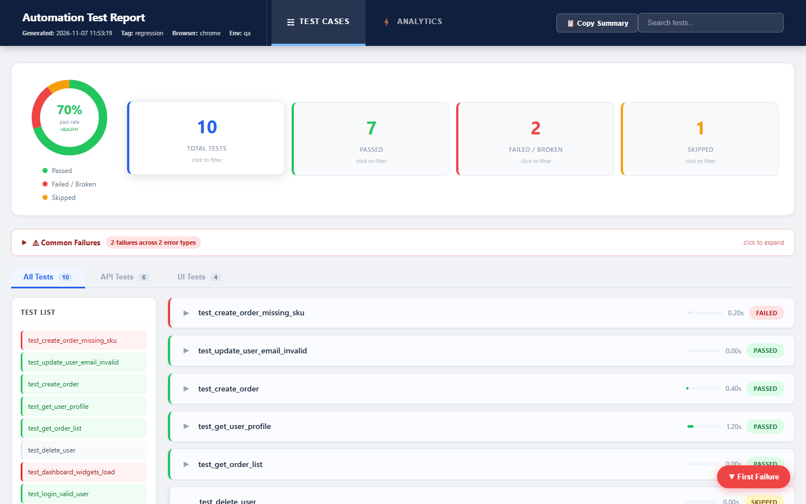
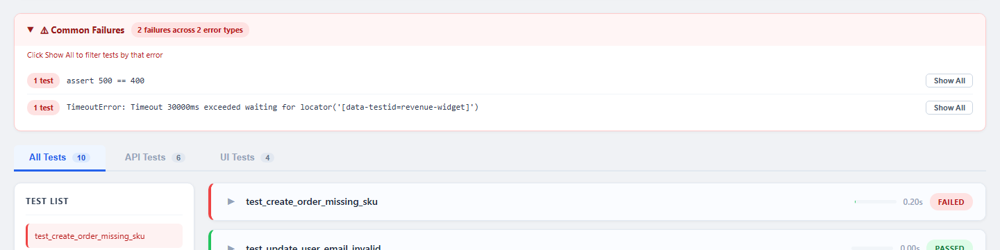
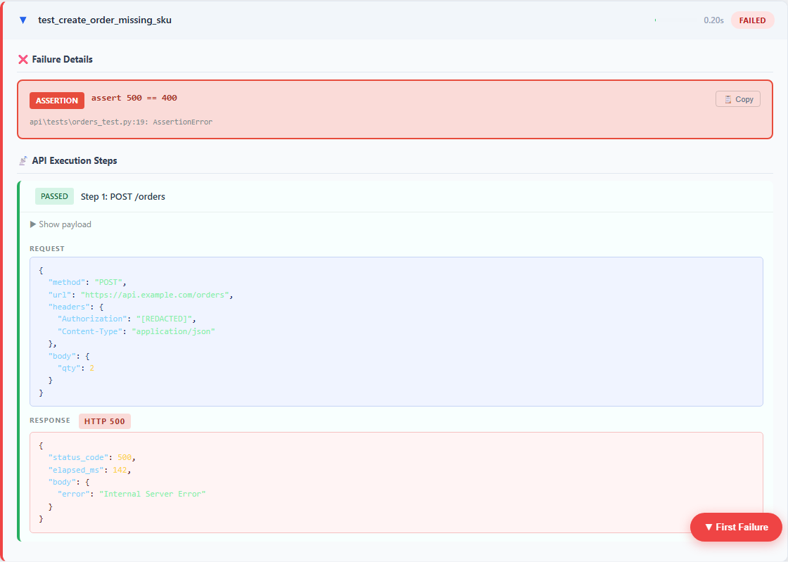
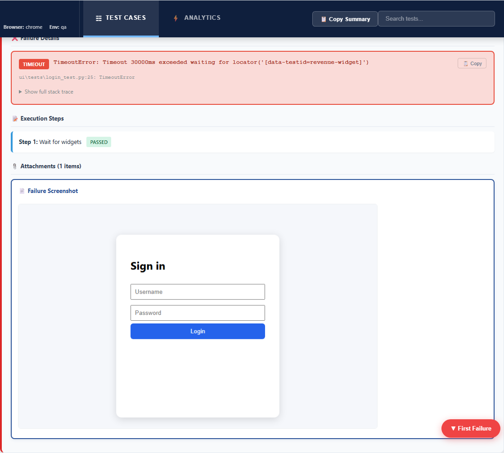
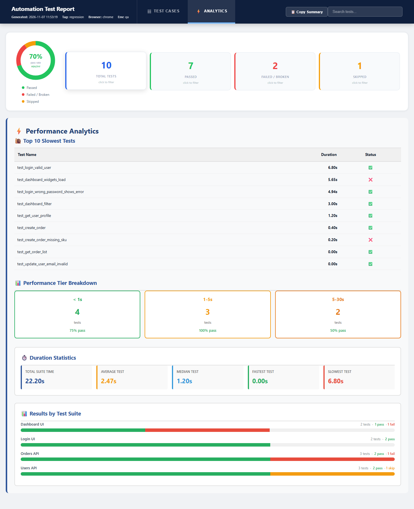

# Playwright + Requests Test Automation Framework

**A plug-and-play Python framework for UI and API test automation, with a single-file HTML report built for triage and AI skills that write, fix and review tests for you.**

[](../../actions/workflows/ci.yml)




---

## Why this framework?

| | What you get |
|---|---|
| 🔌 **Plug and play** | Point it at your app with environment variables and you can start testing. You don't edit any framework code. UI, API and DB layers each work on their own. |
| 📊 **Triage-first HTML report** | One self-contained HTML file opens failures first. It groups them by root cause, shows API request and response payloads inline, embeds screenshots, and includes performance analytics. |
| 🤖 **AI skills built in** | `/write-test`, `/self-heal`, `/self-heal-ui` and `/review-test` work in Claude Code and GitHub Copilot. All of them follow the same written conventions. |
| 🔐 **Secret-free by design** | Config holds only `${ENV_VAR}` placeholders. Allure and the HTML report redact auth headers and mask JWTs, and CI runs a secret scan. |
| ⚡ **CI ready** | Runs headless automatically in CI and in parallel with `pytest-xdist`. It ships an Azure DevOps pipeline and GitHub Actions, and every run produces a report artifact. |
| 🧠 **Change-impact tooling** | An import-graph "repo brain" tells you which tests a code change affects. A quality checker blocks common anti-patterns. |

---

## ✨ The HTML report: unique features

`report_generator_enhanced.py` turns raw Allure results into **one portable HTML file**. Screenshots are embedded as base64, so there is no server, no Allure CLI and no Java. You can email it, attach it to a CI run or open it offline.

### At a glance
- **Animated pass-rate donut** with a health label, plus run metadata: generated time, tag, browser and environment.
- **Clickable stat cards** for Total, Passed, Failed/Broken and Skipped. Each card also works as a filter.
- **Failures first**: failed and broken tests are sorted to the top, then passed, then skipped.
- **📋 Copy Summary**: one click puts a plain-text run summary on your clipboard for Slack, Teams or email.
- **Live search** across all tests, and a **sidebar test list** that jumps to any test.
- **▼ First Failure** floating button that goes straight to the first problem.

### Root-cause grouping: "Common Failures"
Failures with the same key error are grouped together. Click **Show All** to filter the report to that one root cause. Ten tests failing on one timeout show up as a single row, not ten.



### API tests: request and response inline
Each API step shows its **request** (method, URL, headers, body) and its **response** (status, timing, body) as syntax-highlighted JSON. Each step also gets an HTTP-status badge and a hint when the response was null. Auth headers are redacted at capture time.



### UI tests: steps and screenshots
- Each failure is tagged **Assertion**, **Timeout** or **Exception**.
- The failure card shows the key error line and the `file:line` reference, with a **Copy** button.
- The full stack trace is collapsible. Long config dumps are truncated and JWTs are masked.
- Every step shows its status.
- Screenshots are embedded inline and open in a **lightbox** (Esc closes it). The failure screenshot is captured automatically.



### Separate API and UI views
The **All / API / UI / Other** tabs split the run by layer. Each test card has a **duration bar** coloured against the run average: green is fast, amber is slower than average, red is more than twice the average.

### ⚡ Performance analytics tab
- **Top 10 slowest tests**
- **Duration tiers** (< 1s, 1–5s, 5–30s, 30s+), each with its own pass rate
- **Duration statistics**: total, average, median, fastest and slowest
- **Results by suite**: stacked pass, fail and skip bars for each Allure suite



### Also included
- A **JSON data export** next to the HTML (`<date>_data.json`) for dashboards or trend tooling.
- `report_generator.py`, a lighter report with sensitive-data redaction and build-number naming.
- `conftest_plugin.py`, an instant pass/fail summary in the console: `pytest -p conftest_plugin --alluredir=...`.

```bash
python report_generator_enhanced.py allure-results/local reports/enhanced \
  --test-tag regression --test-env uat --test-browser chrome
# -> reports/enhanced/<date>_report_enhanced.html + <date>_data.json
```

---

## 🔌 Plug and play in 5 minutes

```bash
git clone <this-repo> && cd <this-repo>
python -m venv .venv && .venv\Scripts\activate      # macOS/Linux: source .venv/bin/activate
pip install -r requirements.txt
playwright install
cp .env.example .env                                  # fill in your app's URLs and test users
pytest -m example --test-env=qa                       # template tests run once configured
```

That's all the setup. The two template tests skip politely until `UI_BASE_URL` and `API_BASE_URL` are set.

### What "plug and play" means here
- **Zero code changes to onboard an app.** URLs, users and auth come from env vars through `config/<env>.json`.
- **Auth is a config switch.** Set `API_AUTH_TYPE` to `none`, `bearer`, `basic`, `api_key` or `oauth_client_credentials`, and the `api_client` fixture is pre-authenticated.
- **Layers are independent.** Use only the API layer, only the UI layer, or both. The DB layer is optional, and its tests skip when it isn't configured.
- **Environments are just files.** Add `config/staging.json`, then run `--test-env=staging`.
- **Browsers are just flags.** `--test-browser=chrome|edge|firefox|webkit`, plus `--headless`.

---

## 🤖 AI skills

The repo ships an AI assistance layer: [`AGENTS.md`](AGENTS.md), [`AI/`](AI), `.claude/commands/` and `.github/prompts/`. Every skill reads the same rulebook, [`AI/conventions.md`](AI/conventions.md), so generated code matches hand-written code.

| Skill | Claude Code | Copilot | What it does |
|---|---|---|---|
| **write-test** | `/write-test api "create item, missing name returns 400"` | `write-test.prompt.md` | Learns from the existing tests, fixtures and builders, checks the import graph so it never invents modules, then writes a marked, Allure-annotated test. It creates a new builder or page object only when one is needed. |
| **self-heal** | `/self-heal api/tests/<file>` | `self-heal.prompt.md` | Diagnoses a failing test from pytest output and Allure JSON. It fixes the test or builder, never app code, and reports environment issues instead of masking them. |
| **self-heal-ui** | `/self-heal-ui ui/tests/<file>` | `self-heal-ui.prompt.md` | UI version of self-heal. It uses the **Playwright MCP** server (`.mcp.json`) to inspect the live page, then fixes locators and waits in `ui/pages/`, preferring `data-testid` and role selectors. |
| **review-test** | `/review-test [file]` | `review-test.prompt.md` | Checks a file or diff against a checklist: markers, Allure, no sleeps, no hardcoded secrets, no Playwright in tests, fixture hygiene. It reports BLOCK, WARN or SUGGEST and ends with a push verdict. |

Supporting tools in `qa_agent/`:
- `update_brain.py` builds `repo_brain.json`, the import graph, and detects circular dependencies and tests that import other tests.
- `impact_analyzer.py` lists the tests affected by a set of changed files and suggests the pytest command to run.
- `quality_checker.py` runs static checks for unregistered markers, hardcoded URLs and credentials, and similar issues.
- `results_checker.py` and `review_summary_cli.py` produce a pass/fail gate, and the summary can be posted to a PR (`.github/workflows/attach-review-summary.yml`).

---

## 🧰 What's in the box

### UI layer (Playwright, async)
- **`BasePage`**: click, input, select and type helpers with built-in network-idle and DOM-stability waits and auto-scroll. Also visibility and attribute helpers, `wait_for_loader`, `goto`, `expect_url_contains`, and screenshots with automatic cleanup.
- **`LoginPage`**: a generic login page object with overridable locators.
- **`DriverManager`**: CI-aware launcher. It runs headless with a fixed viewport in CI and maximized locally, uses memory-safe Chromium flags, and supports optional video and trace.
- **`HealingLocator`**: self-healing selectors. It tries an ordered list of candidates and caches the one that works.
- **Visual regression** (`check_visual_regression`) and **DOM snapshot** diffs, with baseline, current and diff images attached to Allure.
- **`runtime_data`**: a JSON key/value store for passing IDs between tests or flows.

### API layer (requests, sync)
- **`APIRequest`**: a session-based client with get, post, put, patch and delete, base-URL joining, timeouts and Allure steps.
- **Assertions**: `assert_status`, `assert_json_keys`, `assert_json_schema`.
- **Auto-reporting**: every HTTP call is attached to Allure with headers redacted. You write no extra code for it.
- **`wait_utils`**: `wait_for_condition`, `wait_for_state`, `wait_for_key`, `wait_for_db_record`. Use these instead of `time.sleep()`.
- **`validation_utils`**: data-driven negative testing (`apply_case`, `assert_case_simple`).
- **Locust**: load-run any pytest marker (`api/utils/run_locust.py`).

### Data layer (optional)
- **`DB/db_utils.py`**: SQL Server through pyodbc, with `fetch_all`, `fetch_one`, `execute` and a `db_conn` fixture.

---

## ⚙️ Configuration

Each value is resolved from the first source that has it:

1. Environment variables, for CI secrets.
2. A `.env` file, for local runs (git-ignored).
3. Defaults in `config/<env>.json`.

| Section | Keys |
|---|---|
| `api` | `base_url`, `timeout`, `verify_ssl`, `auth.type` = `none` \| `bearer` \| `basic` \| `api_key` \| `oauth_client_credentials` |
| `ui` | `base_url`, `default_timeout_ms`, `users.default` / `users.admin` |
| `db` | `server`, `database`, `uid`, `pwd` |

Use `${VAR}` or `${VAR:-default}` in any config value. Personal overrides go in `config/<env>.local.json`, which is git-ignored. Read values in code with `get_value(cfg, "ui.users.default.username", required=True)`.

## ▶️ Running

```bash
pytest -m regression --test-env=uat --test-browser=chrome -n2 --alluredir=allure-results/local   # everything, parallel
pytest -m apiregression --test-env=uat                                                           # API only
pytest -m uiregression  --test-env=uat --test-browser=firefox --headless                         # UI only
```

Markers: `regression`, `sanity`, `apiregression`, `apisanity`, `uiregression`, `uisanity`, `db`, `example`.

## 🗂️ Structure

```
common/config_loader.py   ${VAR} config resolution
conftest.py               CLI options + fixtures: config, ui_config, api_config, base, db_conn
api/  conftest.py         api_client fixture, auto request/response reporting
      data/               auth, payload builders, validation helpers
      utils/              APIRequest, waits, Locust runner
      tests/              *_test.py   (template: example_api_test.py)
ui/   pages/              BasePage, LoginPage, your page objects
      utils/              DriverManager, HealingLocator, visual regression, runtime data
      tests/              *_test.py   (template: example_ui_test.py)
DB/                       SQL helpers
qa_agent/                 repo brain, impact analysis, quality gate
AI/ AGENTS.md .claude/ .github/prompts/   AI skills and conventions
report_generator_enhanced.py              the HTML report
```

## ➕ Extending

**New page object.** Add `ui/pages/<page>.py` with locators as class attributes and methods that wrap `BasePage`. Tests call only page-object methods.

**New API test.** Put payload builders in `api/data/<feature>.py`, copy `api/tests/example_api_test.py`, and use the `api_client` fixture:

```python
@pytest.mark.apiregression
def test_create_item(api_client):
    response = api_client.post("/items", json=build_item_payload(name="demo"))
    assert_status(response, 201)
    item_id = assert_json_keys(response, "id")["id"]
    item = wait_for_state(lambda: api_client.get(f"/items/{item_id}").json(), "status", "READY")
    assert item, "item never reached READY"
```

Or let the AI do it: `/write-test api "create item returns 201 and becomes READY"`.

**Rules:** no `time.sleep()`, no hardcoded URLs or credentials, no raw Playwright in tests. Run `python qa_agent/update_brain.py` after changing imports. Full conventions are in [`AI/conventions.md`](AI/conventions.md).

---

## 🚀 Roadmap and enhancement ideas

**Reporting**
- [ ] **Run-to-run trends**: compare against previous runs for the same tag and environment. The scaffolding exists in the report generator but isn't wired in yet.
- [ ] **Flaky-test detection** across historical runs, using pass/fail flip rate and duration anomalies.
- [ ] Embed **Playwright traces and videos** for failed UI tests.
- [ ] Dark mode, plus CSV/PDF export of the report.
- [ ] Slack and Teams notification with the Copy Summary text and a report link.

**Framework**
- [ ] Packaging as a `pip install`-able library and a cookiecutter or template-repo generator.
- [ ] Async API client (`httpx`) and GraphQL helpers.
- [ ] Contract testing with OpenAPI schema validation generated from a spec.
- [ ] Test-data factories (Faker) and cleanup hooks.
- [ ] Accessibility checks (axe-core) and Lighthouse performance budgets in `BasePage`.
- [ ] Mobile web emulation and device-matrix runs.
- [ ] Docker image and docker-compose for one-command CI runners.
- [ ] Database adapters beyond SQL Server (PostgreSQL, MySQL).

**AI**
- [ ] Auto-run `/self-heal` on CI failures and open a fix PR.
- [ ] Generate tests from OpenAPI specs or recorded user flows.
- [ ] AI-written failure summaries inside the HTML report.
- [ ] Learned-patterns refresh after each merge (`qa_agent/hooks/post_merge_handler.py`).

Contributions are welcome. See [CONTRIBUTING.md](CONTRIBUTING.md).

## 🔐 Security

See [SECURITY.md](SECURITY.md). Never commit `.env`, `*.local.json`, or reports and screenshots from real environments.

## 📄 License

[MIT](LICENSE)
